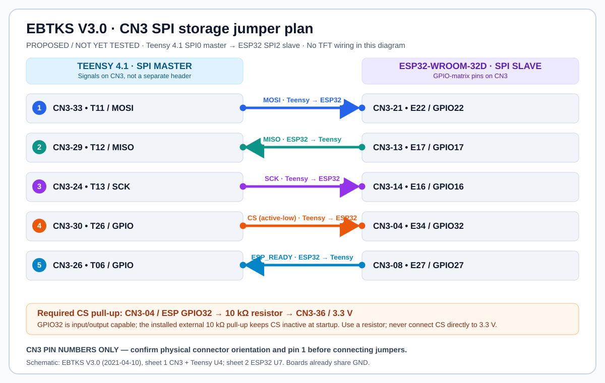

# Proposed CN3 wiring: Teensy-master SPI storage link

> **WIRING RESOLVED BY PHYSICAL MEASUREMENT — 2026-10-18.** The user verified continuity on their actual EBTKS board with a multimeter from **ESP32-WROOM module pad 28 (GPIO17) to CN3-17**, and end-to-end from **Teensy module pin 12 / CN3-29 to ESP32 module pad 28** after correcting the jumper. The **actual MISO jumper is CN3-29 ↔ CN3-17** on this board. The published EBTKS V3.0 schematic instead shows `E17` on CN3-15, and CN3-13 is `E04`/GPIO4: the original project proposal incorrectly called CN3-13 GPIO17. With the measured jumper, full-duplex SPI **mode 0 at 8 MHz** repeatedly passed 128×512 B in both directions. Use the measured board-specific mapping; confirm continuity for a different PCB revision.

**Original proposal (historical):** The wiring was subsequently installed, and the first 1 MHz / 512-byte SPI transfer passed on physical hardware on 2026-10-18 (run 13, 4543 us, matching CRC 59244). The 1–8 MHz / 128-sector extension remains unverified; see [SPI_TEST_README.md](SPI_TEST_README.md). The following is retained as the original proposal, including older tentative test steps. Based on the supplied *EBTKS V3.0 schematic* (2021-04-10), **sheet 1 (CN3 and Teensy U4.1)** and **sheet 2 (ESP32 U7)**.

This is the optional bulk-data link for speeding up CP/M SD operations. The Teensy 4.1 would be the **SPI0 master** and initiate each transfer when its HP bus work permits; the ESP32-WROOM-32D would be an **SPI2/HSPI slave**. The existing ESP↔Teensy UART1 (GPIO3/GPIO1, 115200 baud) continues carrying JSON commands/status and must **not** be repurposed. The Teensy's microSD socket uses its own SDIO interface, not these SPI0 pins.

[Open full-size, editable wiring diagram](docs/CN3_SPI_JUMPERS.svg)

## Five CN3-to-CN3 signal jumpers

| Signal | Teensy endpoint on CN3 | ESP32 endpoint on CN3 | Direction |
|---|---|---|---|
| MOSI | **33** — `T11`, Teensy pin **11** | **21** — `E22`, ESP32 **GPIO22** | Teensy → ESP32 |
| MISO | **29** — `T12`, Teensy pin **12** | **17** — physically verified to ESP32 **GPIO17 / WROOM module pad 28** (published schematic incorrectly labels E17 at CN3-15) | ESP32 → Teensy |
| SCK | **24** — `T13`, Teensy pin **13** | **14** — `E16`, ESP32 **GPIO16** | Teensy → ESP32 |
| CS_N (active low) | **30** — `T26`, Teensy pin **26** | **4** — `E34`, ESP32 **GPIO32** | Teensy → ESP32 |
| ESP_READY (active high) | **26** — `T06`, Teensy pin **6** | **8** — `E27`, ESP32 **GPIO27** | ESP32 → Teensy |

**Confirmed hardware override:** Earlier statements placing ESP GPIO17 at CN3-13 were incorrect; the published drawing indicates CN3-15 but **the user's actual, continuity-tested board is CN3-17**. Neither net label nor printed CN3 schematic alone is sufficient for a different board revision.

### Additional passive component (required)

Install a **10 kΩ pull-up resistor** between **CN3 pin 4** (ESP32 GPIO32 / CS_N) and **CN3 pin 36** (3.3 V; pin 35 is also 3.3 V). This keeps CS deselected during boot/reset. GPIO32 is input/output capable and has an internal pull-up, but retain the installed external 10 kΩ pull-up for a defined idle CS. **Do not connect CS directly to 3.3 V.** Teensy T26 must drive CS_N high when idle, then low during a transfer.

The processors share EBTKS board ground, so **no separate ground jumper is necessary** between these on-board CN3 endpoints. CN3 also has ground on pins 1/2/39/40. All signals are **3.3 V logic**, not 5 V.

**Connector orientation:** the connector symbol lists **odd pins on the left and even pins on the right**; CN3-1/2 are the top pair in the drawing. **Confirm physical CN3 pin 1 and header orientation on the real board** before attaching anything. The SVG is a *signal/connection diagram*, not a physical cable orientation or wiring-by-wire-position drawing.

## Tentative firmware handshake (to validate)

1. ESP32 queues a 512-byte SPI slave DMA transaction and then drives **ESP_READY high**. Default/inactive should be **low**.
2. Teensy processes the UART/JSON disk request and SD operation, continuing to prioritize HP bus service.
3. When the Teensy sees ESP_READY high, it asserts **CS_N low**, supplies SCK and transfers **exactly the agreed number of bytes**, then deasserts CS_N.
4. ESP32 completes the transaction, returns ESP_READY low, and exchanges validation/status over the existing UART control channel. Use a sequence number, CRC, timeouts and an error fallback to the current UART/Base64 path.

**Open feasibility tests:** GPIO-matrix support for ESP32 SPI2 *slave* with GPIO32 as CS, supported maximum SPI speed using remapped signals, Teensy SPI0 timing while servicing HP bus interrupts, hardware DMA/handshake sequencing, and chip-select idle behavior. Begin at a conservative SPI clock, e.g. **4 MHz**, and test reads before writes. Do not connect a powered board or flash untested changes without an explicit bring-up plan.

## TFT connection reserved, not finalized

A future display can have a **separate ESP32 SPI3/VSPI master** channel, so its traffic will not share the new Teensy SPI bus. The *candidate* TFT SPI pins from the schematic are GPIO23 (`E23`/CN3-22 MOSI), GPIO19 (`E19`/CN3-18 MISO), GPIO18 (published `E18`/CN3-17 SCK; **conflicts with physically verified GPIO17 on this board—reverify TFT pinout before using**) and GPIO5 (`E05`/CN3-16 CS). Other display, backlight and touch pins are **not assigned here**; verify the actual TFT and voltage/power specifications on arrival. GPIO5 is a strapping pin.

Nothing in this document changes the currently working Teensy, CP/M, WebSocket VT100, Wi-Fi or OTA firmware. See [PROJECT_STATUS.md](PROJECT_STATUS.md) for the tested baseline.
